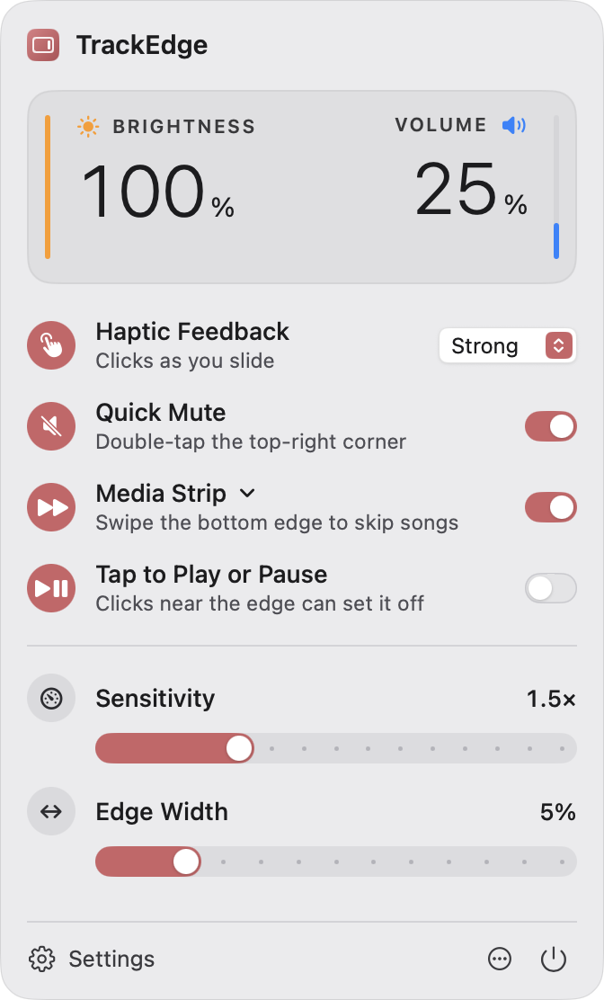
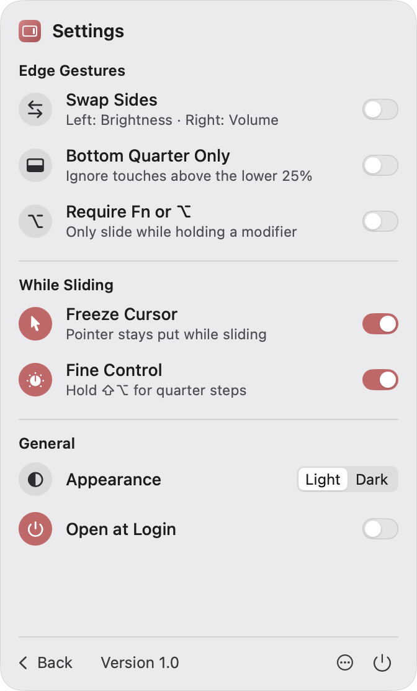
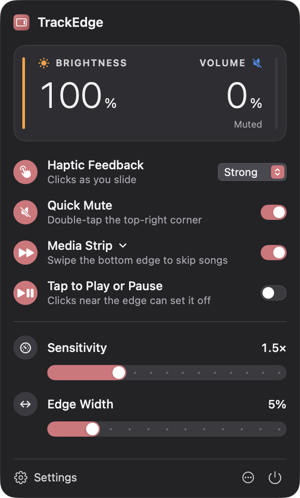

# TrackEdge

<p align="center">
  <a href="https://github.com/a-riceeater/trackswipe/releases/latest"></a>
</p>

<p align="center">
  <a href="https://github.com/a-riceeater/trackswipe/releases/latest"></a>
  <a href="https://github.com/a-riceeater/trackswipe/releases"></a>
  
  
  <a href="LICENSE"></a>
</p>

TrackEdge is a native macOS menu-bar utility that turns the edges of your trackpad into controls. Slide a finger up or down the **left edge** to change display brightness, or the **right edge** to change volume. Double-tap the **top-right corner** to mute, and swipe along the **bottom edge** to skip tracks. It works in any app, shows macOS's own volume/brightness HUD, and gives a haptic tick for each step.

<p>
  
  
  
</p>

It's written in Swift and SwiftUI, with AppKit for the status item and panel. It has no third-party dependencies and targets **macOS 13 Ventura or later**.

> **Direct distribution only.** TrackEdge relies on private Apple frameworks and runs outside the App Sandbox, so it can't ship through the Mac App Store. See [Private APIs](#private-apis).

---

## Features

| Feature | Behavior | Default |
|---|---|---|
| **Edge sliders** | Left edge = brightness, right edge = volume. Up raises, down lowers. Movement is relative, so a slide never jumps to an absolute value. | On |
| **Swap Sides** | Flip the two sides. | Off |
| **Bottom Quarter Only** | A slide must start in the lower 25% of the edge. The media strip is unaffected. | Off |
| **Require Fn or ⌥** | A slide only starts, and only continues, while Fn/Globe or Option is held. Taps and the media strip aren't gated. | Off |
| **Quick Mute** | Double-tap the top-right corner to toggle output mute. | On |
| **Media Strip** | Swipe right along the bottom edge for next track, left for previous. One command per stroke. | On |
| **Tap to Play or Pause** | Tap the bottom strip to play or pause. It only fires after a 0.3 s quiet period and ignores physical clicks. | Off |
| **Haptic Feedback** | Off / Light / Medium / Strong. One Taptic tick per real step, with no tick when pinned at 0% or 100%. Fine-control (⇧⌥) ticks use a softer waveform and are spaced at least 50 ms apart. | Strong |
| **Freeze Cursor** | The pointer stays still while you slide and is always released afterwards. | On |
| **Fine Control** | Hold ⇧⌥ while sliding for quarter steps (1/64), the same as ⇧⌥ + volume key. | On |
| **Sensitivity** | 0.5×–4.0× in 0.25× steps. At 1.0× one step takes 6 mm of finger travel, so 1.5× needs 4 mm. | 1.5× |
| **Edge Width** | 3%–15% of the trackpad width. | 5% |
| **Typing palm rejection** | A touch that starts within 0.75 s of a keystroke is ignored until it lifts, and a keystroke during a touch cancels it. A slide cut short by typing within 1.5 s of starting is undone, so a palm settling in to type can't leave the volume or brightness changed. Always on; needs no permission. | On |
| **Appearance** | App-specific Light/Dark. It doesn't follow the system setting. | Light |
| **Open at Login** | Backed by `SMAppService.mainApp`. The switch shows the real OS registration state. | Off |
| **Automatic updates** | Sparkle checks for new versions daily; ⋯ › Check for Updates… checks now. Updates are signature-verified before install. | On |

The dashboard shows **live** brightness and output-volume percentages read from the OS, and, only when something needs attention, a status indicator (Limited, No Trackpad, Paused or Unavailable). Click it to open **Diagnostics**.

---

## Build & run

Requirements: Xcode 15 or later (developed with Xcode 26.6 / Swift 6.3 in Swift 5 language mode) and [XcodeGen](https://github.com/yonaskolb/XcodeGen) if you want to regenerate the project.

```sh
# Optional: regenerate TrackEdge.xcodeproj from project.yml (the generated project is committed)
xcodegen generate

# Build and launch
xcodebuild -project TrackEdge.xcodeproj -scheme TrackEdge -configuration Debug -derivedDataPath build/DerivedData build
open build/DerivedData/Build/Products/Debug/TrackEdge.app

# Unit tests (80 tests: recognizer, step math, dispatcher, settings)
xcodebuild -project TrackEdge.xcodeproj -scheme TrackEdge -derivedDataPath build/DerivedData test
```

Or open `TrackEdge.xcodeproj` in Xcode and run the **TrackEdge** scheme. The app has no Dock icon, so look for the trackpad glyph in the menu bar.

> On a notched MacBook with a busy menu bar, macOS hides status items that don't fit. If the icon is missing, quit a few menu-bar apps or use a menu-bar manager. On macOS 26, also check **System Settings › Menu Bar** in case the item is switched off.

### Signing and permissions

The project signs ad hoc (`CODE_SIGN_IDENTITY = "-"`) so it builds on any Mac. macOS ties the Accessibility permission to the code signature, and an ad-hoc signature changes on every build, so you'd have to re-grant Accessibility after each rebuild. For day-to-day use, sign with a stable identity:

```sh
xcodebuild ... CODE_SIGN_IDENTITY="Apple Development" CODE_SIGN_STYLE=Manual build
```

---

## Permissions

| Permission | Needed? | What it enables | Without it |
|---|---|---|---|
| **Accessibility** | Recommended | Posting system-defined key events (volume, brightness, mute, media keys). macOS then makes the change itself, shows its native HUD, and routes media keys to the Now Playing app. | Volume and brightness are written directly (CoreAudio / DisplayServices). Feedback uses the Apple HUD on macOS 13–15 or a labelled TrackEdge indicator on macOS 26+. Media commands use MediaRemote. |
| **Input Monitoring** | No (on the versions tested) | — | Shown read-only in Diagnostics. If touches never reach the Touch Inspector on some macOS release, grant it and relaunch. |

When Accessibility is missing, the dashboard shows a one-line "Allow" hint. Diagnostics has deep links into System Settings for both permissions.

---

## How it works

```
MultitouchSupport (private, dlopen)          CGEventSource (modifiers, button)
        │  raw contacts per device                     │
        ▼                                              ▼
 MultitouchProvider ──► GestureEngine ──► GestureRecognizer (pure state machine, one per trackpad)
                              │                      │ typed GestureCommands
                              ▼                      ▼
                       ActionDispatcher ──► VolumeService / BrightnessService / MediaController
                              │                     │            │
                       CursorManager          SystemKeyEmitter   AudioController (CoreAudio)
                       HapticEngine           (native HUD)       DisplayBrightnessController (DisplayServices)
                              │                                  SystemOSDController (OSDManager / fallback)
                              ▼
                        AppModel (@MainActor, ObservableObject) ──► SwiftUI popover / Diagnostics
```

- **`GestureRecognizer`** (`TrackEdge/Domain`) is a deterministic state machine: `idle → candidate → sliding / consumed / blocked`. It sees only normalised contacts (x 0 = left, y 0 = top), modifier state, button state and timestamps. It never calls system APIs and owns no timers. It handles:
  - **Multi-finger input:** any second finger cancels the gesture until every finger lifts, which rejects scrolls, pinches and resting palms.
  - **Dead zone and direction:** a slide needs 2 mm of vertical travel, a 1.5:1 vertical-to-horizontal ratio and less than 3.5 mm of lateral drift before it starts.
  - **Hysteresis:** the step anchor only moves by whole steps, so jitter at a step boundary can't oscillate.
  - **Click rejection:** a physical click or tap-to-click rejects slides and taps.
- **Typing rejection:** `CGEventSource.secondsSinceLastEventType(.hidSystemState, .keyDown)` is sampled with every frame. Touches that begin while you type are ignored, and keystrokes cancel touches in progress or undo recent slides (`slideCancelled`).
  - **Conflict resolution:** in the bottom corners, the dominant direction after the dead zone decides between slide and swipe. A sloppy second Quick Mute tap gets a doubled dead zone, so mute wins over the right-edge slide.
  - **Coalescing:** finger travel is converted into whole-step `adjust` commands and smoothed with a light EMA.
- **Steps match the keyboard exactly.** Normal steps are 1/16 and fine steps 1/64. Off-grid values snap the same way macOS's own keys do, measured on hardware: 0.4776 → 0.5 and 0.6839 → 0.75. See `StepMath`. Because every normal grid point is also a fine one, switching modes mid-slide can't jump or drift.
- **`ActionDispatcher`** runs commands on a serial queue. It freezes and releases the cursor, limits writes to at most 90/s, emits one haptic tick per actual change, and tells the UI to refresh.
- **Coordinate orientation:** MultitouchSupport reports y = 0 at the bottom, and `TouchNormalizer` flips it. The Touch Inspector shows contacts live so you can confirm this, and a developer "Invert Y" override exists in case a device reports the other way.

### Control routes

| Control | Preferred route | Fallback |
|---|---|---|
| Volume / mute | Synthesised `NX_KEYTYPE_SOUND_UP/DOWN/MUTE` (⇧⌥ for quarter steps) → native HUD | CoreAudio `VirtualMainVolume` → main-element scalar → per-channel scalar; soft mute if the device has no hardware mute |
| Brightness | Synthesised `NX_KEYTYPE_BRIGHTNESS_UP/DOWN` → native HUD | `DisplayServicesSetBrightness` on the target display |
| HUD (fallback route only) | `OSDManager` (macOS 13–15) | Labelled TrackEdge indicator (macOS 26+, where `OSDManager` no longer renders) |
| Media | Synthesised `NX_KEYTYPE_NEXT/PREVIOUS/PLAY` | `MRMediaRemoteSendCommand` |
| Haptics | `MTActuatorActuate` on the touching device (waveforms 3/4/6 = Light/Medium/Strong, 1 for all fine steps; IDs aren't ordered by intensity, so tune by feel in `HapticEngine.waveforms`) | `NSHapticFeedbackManager` on Force Touch devices; nothing on older trackpads (no fake sounds) |
| Cursor freeze | `CGAssociateMouseAndMouseCursorPosition(false)` plus re-pinning with `CGWarpMouseCursorPosition` | — |

**Brightness target.** TrackEdge uses the built-in display when the lid is open and DisplayServices can control it. Otherwise it uses the first display DisplayServices can drive, such as a Studio Display, Pro Display XDR or LG UltraFine. Third-party monitors that need **DDC/CI aren't supported**. They show "Unsupported display" rather than a fake gamma dim.

### Reliability and recovery

- **The cursor is never left frozen.** It's released when the slide ends, when a second finger lands, on cancellation, on device change, on sleep, screen sleep, user switch, when Freeze Cursor is turned off, and on quit/SIGTERM/SIGINT/SIGHUP. A watchdog also releases it if touch frames stop for 0.6 s, and every launch force-restores pointer association.
- **Hot-plug:** IOKit notifications on `AppleMultitouchDevice` re-enumerate trackpads, debounced by 0.8 s. Multiple trackpads, such as built-in plus Magic Trackpad, each get their own recognizer. Magic Mouse and Touch Bar surfaces are filtered out.
- **Sleep/wake and session switching:** multitouch stops on sleep and restarts 1.5 s after wake. The status shows "Paused" in between.
- **Audio:** CoreAudio listeners track default-device, volume and mute changes, so there's no polling.
- **Brightness and permissions** are polled once a second, and only while the popover or Diagnostics is visible. An idle app runs no timers.

---

## Private APIs

All of these are loaded at runtime with `dlopen`/`dlsym` or `NSClassFromString`. Each one is isolated in its own service, and a missing symbol degrades that feature instead of crashing the app.

| Framework | Used for | File |
|---|---|---|
| `MultitouchSupport.framework` | Global per-finger touch data; Taptic actuator | `Services/Multitouch/MultitouchBridge.swift` |
| `DisplayServices.framework` | Read/set display brightness | `Services/System/DisplayBrightnessController.swift` |
| `OSD.framework` (`OSDManager`) | Native HUD on the direct-write route (macOS 13–15) | `Services/System/SystemOSDController.swift` |
| `MediaRemote.framework` | Media commands when Accessibility is not granted | `Services/System/MediaController.swift` |

The C layout of the touch record lives in `TrackEdge/Bridging/MultitouchTypes.h` and is checked at runtime against a 96-byte stride. No protected system files are modified, and SIP stays on.

---

## Developer tools

- **Diagnostics** (⋯ menu › Diagnostics…) shows subsystem status, active routes, live modifier keys (to verify Fn/Globe detection), connected trackpads with size, family and haptic support, and permission buttons. It also has **backend self-test buttons** for volume, mute, brightness, media and haptics that work without any gesture, plus a **haptic waveform tester** (IDs 1–6) for retuning how each strength feels.
- **Touch Inspector** is in Diagnostics and is off by default. It draws the trackpad with its edge, corner and strip zones, live contact IDs and coordinates, the recognizer state, and the last 14 commands. Nothing is written to disk.
- **DEBUG-only launch arguments:**
  - `-selfTest YES` steps volume and brightness ±1 and ±¼ through the active route, checks the result against the hardware, restores the original values, prints a report and exits.
  - `-forceDirectRoute YES` simulates a Mac without Accessibility.
  - `-debugOpenPanel dashboard|settings` opens the popover pinned at launch, for screenshots.

```sh
build/DerivedData/Build/Products/Debug/TrackEdge.app/Contents/MacOS/TrackEdge -selfTest YES
```

---

## Verification status

**Automated and verified on a MacBook Air (Apple Silicon, macOS 26.6.1, built-in Force Touch trackpad, family 110):**

- Debug and Release builds succeed with no Swift warnings, and `scripts/package.sh` archives, signs and zips the app.
- All 80 unit tests pass.
- MultitouchSupport loads, the built-in trackpad starts (121.9 × 74.1 mm), and its Taptic actuator opens.
- `-selfTest`, through both the key route and the direct route, gave the expected result for every step: volume ±1/16 and ±1/64, brightness ±1/16 and ±1/64. Original values were restored afterwards.
- Synthesised volume keys show the native macOS 26 volume HUD. `OSDManager` resolves on macOS 26 but renders nothing, which is why macOS 26+ uses the fallback indicator.
- The popover was captured in light and dark mode and compared with the design reference.

**Still needs a person with a finger on the trackpad:**

1. Coordinate orientation in the Touch Inspector: top of the pad reads y ≈ 0, left reads x ≈ 0.
2. Feel and thresholds of left/right slides: direction, sensitivity, edge width, dead zone, and ordinary pointer use and scrolling staying unaffected.
3. Swap Sides, Bottom Quarter Only, and Require Fn or ⌥, including that Fn/Globe registers under "Live modifiers".
4. Quick Mute double-tap, with ordinary corner clicks and double-clicks *not* muting.
5. Media Strip next/previous with Music and Spotify; optional tap play/pause; that MediaRemote works when Accessibility is off.
6. Fine Control (⇧⌥) with a physically held ⌥ under "Require Fn or ⌥": confirm the key route never opens Sound settings.
7. Haptic strengths feel distinct (Light/Medium/Strong) and fine-step ticks feel lighter; Off is silent. Use the waveform tester to retune if needed.
8. Freeze Cursor keeps the pointer still while TrackEdge is in the background, and always releases on lift, quit, sleep and lid close.
9. Open at Login survives logout and login, including a launch from `/Applications`.
10. Magic Trackpad connect, disconnect and reconnect; sleep/wake; switching audio output (AirPods, HDMI fixed-volume); external Apple and non-Apple displays.
11. A Finder-launched copy without Accessibility shows the hint, and permission changes are picked up live.

---

## Limitations

- Requires private frameworks, so this is a direct-distribution build only. It can't be sandboxed or shipped through the Mac App Store, and a future macOS release could change these frameworks.
- No DDC/CI, so third-party external monitors can't have their brightness controlled.
- macOS 26 shows no native HUD on the direct-write route. Grant Accessibility to get the real HUD.
- The edge gestures don't swallow input. One-finger motion along an edge still reaches the frontmost app as pointer movement (frozen when Freeze Cursor is on), and a tap-to-click tap in the corner still clicks.
- The haptic waveform IDs are community-documented values and may feel different across trackpad generations.

---

## Release

### Versioning

Both numbers live in `project.yml`, and the UI reads them from the bundle.

- **`MARKETING_VERSION`** is the version people see, for example `1.1.0`.
- **`CURRENT_PROJECT_VERSION`** is the build number. It **must go up with every release**, because Sparkle compares build numbers to decide whether an update is newer.

### Packaging

```sh
scripts/package.sh                                            # ad-hoc, local testing only
SIGN_IDENTITY="Developer ID Application: Name (TEAMID)" \
NOTARY_PROFILE=my-notary-profile \
NOTES_FILE=notes.md scripts/package.sh                        # signed, notarized, stapled, added to appcast.xml
```

`NOTES_FILE` is optional release notes in simple Markdown (headings, bullet lists, **bold**, `code`). They appear in the update window.

This produces two equivalent artifacts in `dist/`:

- **`TrackEdge-<version>.dmg`**, the recommended download. It holds the app next to an Applications shortcut for drag-to-install. Both the DMG and the app inside are signed, notarized and stapled.
- **`TrackEdge-<version>.zip`**, the same notarized app. Sparkle downloads this one.

Both builds are universal (arm64 + x86_64). The hardened runtime is on, the entitlements file explicitly disables the sandbox, and Sparkle's embedded helpers are re-signed with the same Developer ID. Install the app in `/Applications` so login-item registration is stable.

### Publishing

```sh
scripts/publish_release.sh notes.md
```

This creates the GitHub release (tag = version) with the DMG and zip attached. It waits until the zip is downloadable, then commits and pushes `appcast.xml`. That order matters: if the appcast were pushed first, installed copies would be offered a download that doesn't exist yet.

### Auto-updates (Sparkle)

TrackEdge updates itself with [Sparkle 2](https://sparkle-project.org).

- **Feed:** the app checks [`appcast.xml`](appcast.xml) on `main` once a day. Users can also choose ⋯ › Check for Updates…, or turn daily checks off in the same menu.
- **Download:** each appcast entry points at the release's zip on GitHub.
- **Signing:** every update is signed with an EdDSA key, and the app only installs updates whose signature matches its built-in public key (`SUPublicEDKey`). Sparkle also requires the same Developer ID signature as the installed app.
- **Private key:** it lives only in the release machine's login keychain. **Back it up**, because without it no future update can be delivered to installed copies:
  ```sh
  build/DerivedData/SourcePackages/artifacts/sparkle/Sparkle/bin/generate_keys -x ~/trackedge-sparkle-private-key
  ```
  Store that file somewhere safe outside the repo. To restore it on another Mac, use `generate_keys -f <file>`.
- **Verified locally:** an installed 1.1.0 found, downloaded and verified a locally served 1.1.1, and was replaced by 1.1.1 (still Developer ID signed) when it quit. A tampered archive was rejected.

## Renaming

"TrackEdge" is a working name. To rename the app, change `name`, `PRODUCT_NAME`, `CFBundleDisplayName`/`CFBundleName` and the bundle IDs in `project.yml`, then run `xcodegen generate`. In-app strings come from `AppInfo.name`.

## Project layout

```
project.yml                 XcodeGen spec (TrackEdge.xcodeproj is generated from it)
TrackEdge/
  App/                      Entry point, AppDelegate, AppModel (composition root), menu bar + panel, self-test
  Domain/                   Pure logic: GestureRecognizer, GestureConfig, StepMath, AppSettings, types
  Services/                 GestureEngine, ActionDispatcher, level services
    Multitouch/             Private-framework bridge, provider, IOKit hot-plug watcher
    System/                 Audio, brightness, media, key emitter, OSD, haptics, cursor, permissions, login item
  UI/                       Theme tokens, controls, dashboard, settings, diagnostics + touch inspector
  Bridging/                 C layout of MultitouchSupport touch records
  Resources/                Info.plist (LSUIElement), entitlements, app icon
TrackEdgeTests/             Recognizer, step math, dispatcher (mocks), settings
scripts/                    generate_icons.swift, package.sh
```

## License

Apache License 2.0. See [LICENSE](LICENSE). TrackEdge is an independent clean-room implementation. It uses no code, assets or branding from other products.
